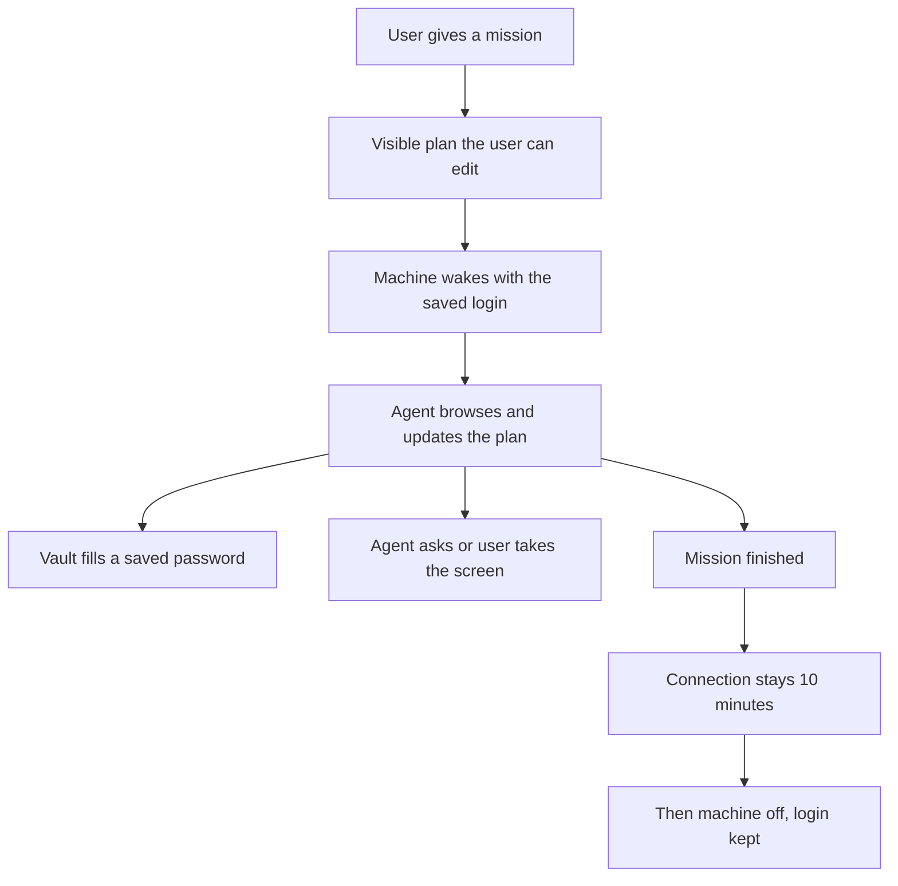

# Opero agent vision

This is the vision to review. It does not choose technology. The technical offer, when you send it, gets checked against this and changed where it disagrees.

## What this phase is

Build one agent that can carry an internet mission through to the end. Opero Home, School, Life, and Business are later wraps on this agent. The daily job of Opero Home is still open between you and your partner, and it is not part of this phase.

When it becomes a product, the people are households in Israel. The product starts in English. Hebrew is a language the user can choose. More languages come later. The agent will meet websites in either language.

## Finish line

One agent, used by the builders, through a simple chat. A mission in ordinary language. A plan they can see and edit in that chat. A real browser they can watch and take over. Sign-in through the vault. The mission finishes without the user rescuing a stuck page. Many households come next, then the Opero Home product UI.

## The three parts

### Browser

The agent uses a real browser the way a person does: open, click, type, stay logged in, and finish. The browser belongs to Opero. Grok Bot is the reference for how this should feel. Grok Bot’s computer is not an API Opero calls. The model is the brain and can be replaced. The asset is a finished mission.

### Orchestrator

The agent writes a visible plan. The user can correct it. The agent updates the plan while it works. Building the plan includes understanding where this user wants a pause, for approval or for watching.

Two modes ship in the first agent. The user picks the level.

- Level 1: the agent asks only before a step that submits, deletes, sends, or changes an account. Reading, navigating, and other clicks proceed.
- Level 2: the agent acts on its own. It still stops for a pause the user wrote, a missing secret, a missing fact, a rejected detail, or an end it cannot verify.

Asking because the level or the plan says so is normal. A rescue is the agent stuck on a page and unable to continue. The first agent must not need that rescue.

### Vault

The vault stores details, each with a description of the case it fits, such as a password or a card number. When a form asks for details, the agent looks for one saved entry that fits that description. A match is filled, and the agent does not see the value. No match, or more than one match, asks the user. A password and a payment field use this same path. After a login, the browser keeps the session.

One person manages the house in this phase. That person has one vault and one browser. A House is the record those belong to, so later the same house can hold more users. Those extra users, and a split between shared and personal passwords, are not built now.

## Computer

Each household has an identity that stays: household id, vault, and browser profile. The machine turns on when a mission starts. A website does not need Opero to keep a connection open. After the last activity — the mission reached its end, or the agent asked a question and is waiting — the connection stays up for 10 minutes. A new message in that window uses the same connection and starts the 10 minutes again. When the 10 minutes pass with nothing new, the connection closes and the machine turns off. While it is off, it does not watch the internet. The saved login is still there the next time it wakes.

During a mission there is a live screen. The user can take control and hand the work back. While the user has the screen, the agent makes no clicks. On hand-back, the page the user left is the current page, and the end stays unless the user changed it.

## Conversation

This phase includes one simple chat, the same idea as Grok Bot's chat and no other part of that product. The household has one thread.

The user gives the mission in the thread, sees the plan, edits it, answers questions, and can attach a file the mission needs. The agent writes the plan, its questions, and the result in the same thread. The live screen opens from the thread while a mission runs. The chat starts in English, and the user can choose Hebrew.

Routines, a vault settings product, a sidebar of many bots, and the Opero Home skin are later. They are not this chat.

## When the user is pulled in

The agent asks in the chat when it lacks a password, when a site needs a code or a tap on the person’s phone, or when sign-in is something the vault cannot fill: Google, a passkey, an authenticator, an email link, or a bank-app approval. The user can send a code and the agent types it, or take the screen and do that step. The agent does not bypass the check.

A stored vault password is filled without the agent seeing it. A value the user sends in that question is used for that step, so the agent handles it in the moment.

The agent sees the screen. You also accepted that the agent may read the browser cookie when that helps it act. A cookie is the key that keeps the site logged in. A hostile page can try to persuade an agent that can read cookies to copy them out. That choice is recorded as accepted.

## Zero mistakes

The agent finishes the mission. The user is not called to repair a browsing failure. The allowed interruptions are a missing detail, a sign-in the vault cannot fill, a phone code, a missing fact, a rejected detail, an end that cannot be verified, a pause the user wrote, a Level 1 ask before a submit, delete, send, or account change, and the user choosing to take the screen.

On its own, the agent is expected to clear the ordinary failures of the web: a changed layout, a popup, a slow or failed load, a logout followed by a vault login, a site that blocks a cloud address, a wrong page, and a site language that differs from the conversation. For a site that blocks a cloud address, the behavior to match is Grok Bot’s. The mechanism is an architecture decision.

## Hard cases

These are decided from the vision above. They keep a mission from stopping in silence, and they keep the agent from guessing.

- Rejected detail. One attempt for that description. If the site rejects the password, the card, or warns of a lock, the agent stops and asks. It does not try that description again. A replacement is saved only if the user says to save it.
- Missing fact. A student number, an address, which child, or which account is a reason to ask when the user has not already said it in the chat. The agent does not guess and does not submit.
- Pauses. Level 1 asks before a final action. Level 2 does not add that ask on its own. The agent may add a pause. It may not remove a pause the user wrote. Only the user can remove it.
- Money. A payment field is a details fill. The agent uses a saved card or payment detail when one vault entry fits that description. Otherwise it asks. There is no separate checkout stop.
- A file the site asks for. The user attaches it in the chat, and the agent uploads that attachment. Camera, location, and notification prompts are refused. The user can take the screen and allow one when the mission needs it.
- Orders from the page. Instructions come from the user and the plan. Page text is information about the page. The agent ignores a page that says to drop the mission, submit something else, or copy a cookie or password. It does not type a cookie or a vault password into the chat or into a field the mission did not ask for.
- Edit during a step. The current click finishes. The agent then reads the edited plan. It does not undo work already done. It says what already happened and continues from the edited plan.
- Done. The mission is done only when the evidence named in the end is visible. A success banner without that evidence is not the end. A submit is not sent twice. If the agent cannot tell whether a submit landed, it stops and asks.
- Silence. The question stays in the chat. The mission is saved as waiting. The connection stays up for 10 minutes, then closes. When the user returns after that, the same mission wakes and asks again. Silence does not fail the mission.
- Two requests. One mission runs. The next request waits in the chat until the current mission ends or the user stops it.
- Computer failure. The mission is not marked done. The chat says what failed. A submit is not repeated. The agent wakes again, looks at the page, and checks the end. If the end is already true, it stops. If the machine cannot wake, it says so and waits.

Wrong account. This phase has one person per house, so there is no switch between family members. If the open session is a different account than the mission names, the agent stops and asks. It does not sign out unless that person says so. A House is stored as its own record and can hold more users later. Those users are not part of this phase.

## Open decision: files

Left for you to mark on this review.

During a mission the browser can download a file, for example a university letter as a PDF. The question is whether that file still exists after the machine turns off. If yes, the household computer has a folder that survives between missions. If no, the download lives only while the mission runs.

A command line is a second, separate piece. Grok Bot uses it for work that is not clicking a website, such as opening a zip file. This phase can ship with neither the lasting folder nor the command line.

## Out of this phase

The Opero Home job. The Opero Home product UI. The simple chat is in this phase. Several users inside one house. Personal vault entries separate from the house vault. An always-on computer.

## What a detailed plan adds

Reviewed with the writing-plans skill. That skill writes an implementation plan as small steps with exact files, test code, commands, and expected results. It refuses placeholders. A file-by-file plan written today would have to invent the stack, so it would create the mistakes it is meant to prevent. The detail below is the part that can be fixed before any technology is chosen.

### One vocabulary

Later tasks drift when the same word means two things. These meanings stay fixed.

- House: the record that owns the agent, the vault, and the browser. This phase puts one user on it. More users per house come later.
- Mission: the user's request, in ordinary language.
- Plan: the ordered steps the user can see and edit.
- Step: one unit of work. It has text, a status (`pending`, `waiting`, `running`, `done`, `skipped`), and a pause flag.
- Pause: a flag on a step. Both levels stop before a paused step.
- Level: `1` or `2`, chosen by the user for the agent. Level 1 asks only before a step that submits, deletes, sends, or changes an account. Pressing the button that commits that action is the ask. Filling a field, following a link, and dismissing a banner proceed. Level 2 does not ask for those commits unless the user wrote a pause. Both levels stop for a missing detail, a missing fact, a rejected detail, or an end that cannot be verified.
- Vault detail: a saved value with a description of the case it fits. The fill action returns "filled". The value is absent from the text sent to the model.
- One-time value: a code or password the user sends for this step. It is typed into the page. It is stored in the vault only if the user asks to save it.
- Session: the browser profile, including cookies, that remains after the machine turns off.
- Grace: the 10 minutes the connection stays up after the last activity. A message inside it reuses the connection and restarts the 10 minutes. After it, the machine is off.
- End: the checkable outcome written in the plan before the browser acts. The agent stops when it is true.
- Interfere: the user edits the plan, pauses a step, or takes the screen. The agent continues from that point toward the same end.
- Rescue: the mission stalls because the agent cannot choose the next browser action, and the reason is not a Level 1 ask, a pause, a missing secret, or the user interfering. `waiting_on_user` is allowed. A rescue is a failed mission.

Level 1 is decided. The agent asks only before a commit: submit, delete, send, or change an account. Sign-in is a submit, so Level 1 asks before the sign-in button. The vault may fill the form before that ask.

### Four plans, in order

The skill splits a spec that covers several subsystems. Each plan has to produce software that can be tested on its own. Building all of this as one plan hides a failure in the browser inside a failure in the planner.

1. Computer lifecycle. Wake, attach the saved profile, show the live screen, accept takeover, accept hand-back, keep the connection for 10 minutes after the last activity, then shut down. Prove the site is still logged in on the next wake.
2. Vault fill. A login form on a page Opero controls receives the saved password. The text sent to the model does not contain it.
3. Orchestrator. A visible plan names the end before browsing. The user can interfere. Level 1 waits only before a submit, delete, send, or account change. Level 2 runs until a pause or a missing secret. The plan updates while work runs, and the end stays the one the user left in place.
4. One public mission. The three pieces together reach the planned end on a real website and stop, with no rescue. The user interferes once during the run, and the agent continues toward that same end.

The first identity is one builder household. The records are shaped as a household from the start. Multiple households, the product UI, lasting files, and a command line wait until these four pass.

### Proof on a public website

The first full mission runs on a real public website. Before any click, the plan states the end in one checkable sentence, such as the fact to bring back or the confirmation that must be visible. The agent plans that end up front. The user can interfere while it runs: edit the plan, pause a step, or take the screen and hand it back. The agent continues from the current page toward the end the user left in place. Reaching that end and stopping is the pass. A rescue is the fail.

A changed layout, a slow load, a logout, a cloud-address block, a wrong page, or a page in another language is handled by replanning toward that same end. The agent does not invent a new goal. Level 1 asks only if the path to the end includes a submit, a delete, a send, or an account change. Sign-in is one of those asks.

Two checks stay on a login the builders control, because a public page will not sit still long enough to prove them. After shutdown, the same site opens already logged in. The text sent to the model does not contain the vault password. A screenshot may show the page, and a cookie may be read.

## Technical build

Chosen for the first build, so the implementation plan does not invent a second stack.

- The computer is Chrome on the machine running Opero, started by Playwright with a profile directory per house. The site sees that machine's network. A cloud browser is a later plan.
- The chat is one web page. The live screen is a picture of that Chrome, updated in the page.
- The brain is grok-4.7 through the xAI API, behind one interface so it can be replaced.
- The vault is an encrypted file. Filling a password returns "filled" and does not put the password in the model text.
- A download exists only while the machine is on. It is deleted when the connection closes. A lasting folder and a command line are later plans.

## Next

Implement the technical build. The Hebrew document's expense story stays out. Its matching computer rules stay: one identity per household, a real browser, a session that survives, a live screen, and a machine that runs only during a mission, plus the 10 minute grace.
