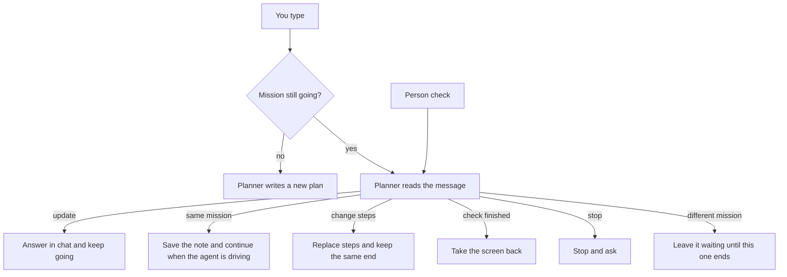

# Mid-mission conversation

> **For agentic workers:** REQUIRED SUB-SKILL: Use superpowers:subagent-driven-development (recommended) or superpowers:executing-plans to implement this plan task-by-task. Steps use checkbox (`- [ ]`) syntax for tracking.

**Goal:** A message during a live mission goes to the planning agent, which can answer, steer, replan, resume, stop, or queue a different mission.

**Architecture:** The chat page sends `steer` while a mission is planning, running, or waiting. The house loop also treats a `mission` message the same way when one is already active, so an old page cannot skip the planner. The planner returns one JSON decision. The end stays fixed. A person-check stays paused unless the planner says the person is done. A yes/no on a submit stays on the existing approval path.

**Tech Stack:** TypeScript, Vitest, the existing `HouseLoop` and `createPlanner`.

## What broke

The screenshot is a person-check on gov.il. The mission is still `running`, and the driver is `user`. The page only sends `answer` after a `question` event, so "עדכון בבקשה" was sent as a new `mission`. `acceptMission` queued it and posted "Queued until the current mission finishes." The planner never saw the sentence.

## Problems this fix has to cover

1. **A live chat line is not a new mission.** Planning, running, and waiting all mean the current mission still owns the thread.
2. **The queue must not bypass the planner.** Queue only when the planner says the line is a different mission.
3. **A person-check is not a question.** Status stays `running`, so the page must still send the line to the planner.
4. **`answer` ignores a running mission.** A steer during `running` cannot depend on `waiting_on_user`.
5. **The current click finishes first.** A line that arrives during `pursue` waits until that action returns, then the planner speaks.
6. **A status reply must not click through a person-check** and must not take the screen back while the driver is `user`.
7. **A submit approval stays yes/no.** The model must not grant or decline a commit. That path stays in `answer`.
8. **The end stays fixed** when the planner replaces steps.
9. **A real second mission still waits** until this one is done or blocked. The planner chooses that with `queue`.
10. **A planner failure does not queue the line** and does not change the mission.
11. **Hebrew and English share one path.** No special case for the word "עדכון".

## Files

- Modify: `src/agent/planner.ts` — `converse` and `parseSteer`
- Modify: `src/agent/loop.ts` — talk to the planner instead of queueing blindly
- Modify: `src/chat/server.ts` — accept `steer`
- Modify: `public/index.html` — send `steer` while a mission is live
- Modify: `src/config.ts` — failure and fallback sentences
- Modify: `docs/architecture.md` — describe the new turn
- Test: `test/steer.test.ts`, `test/loop.test.ts`

## Decisions

- Unknown planner JSON becomes a chat reply, not a queue.
- `resume` is the only decision that sets the driver back to `agent`.
- `guide` and `replan` while the driver is `user`, or while a person-check is on the page, update memory and the chat, then leave the screen with the person.
- The queued sentence stays "Queued until the current mission finishes."
