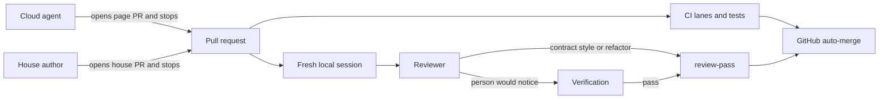

# Split ownership

Cursor Cloud Agents change the page. Local Cursor changes the house. The socket contract is the only shared language. Authors open a pull request and stop. A fresh local session reviews. GitHub merges.



## Zones

- House: `src/`, root `test/`, root `package.json`, `package-lock.json`, `docs/architecture.md`, `.github/`, `.cursor/` except the verify skill, and `scripts/`.
- Page: `frontend/` except `frontend/socket-contract.json`, `frontend/CONTRACT.md`, and `frontend/contract.mjs`.
- Contract: those three files, plus `.cursor/skills/verify-opero/` when a DOM id or a verification button name changes.
- Specs under `docs/superpowers/` ride with the feature that owns them.

`npm run lanes` fails a diff that mixes page and house, or that edits a contract file inside a feature diff. The check reads `LANES_BASE` and `LANES_HEAD` in Actions, and the working tree locally.

## Contract

`frontend/socket-contract.json` lists every message type, field, and shape. `node scripts/generate-contract-tables.mjs` writes the type tables in `frontend/CONTRACT.md`. A test fails when the committed tables are stale.

The page suite fails when `frontend/index.html` sends a type or a literal shape the contract does not allow, including the aliases `steer` and `answer`. The house suite fails when `src/chat/server.ts` or `src/agent/loop.ts` emits one. A shape change in an existing field fails `explainMessage`.

`readSocketFrame` and `readFrame` return null for a bad frame. An unknown type is returned and ignored. `test/socket-open.test.ts` opens a fake house and checks the socket stays open.

Add a message or an optional field in a contract pull request first. House and page pull requests follow, in either order, and keep the previous messages. Remove a type only after both sides have stopped sending it. The reviewer searches `src/` and `frontend/` for that string, excluding the contract files.

Send order and a field's meaning are outside the contract tests. A claim in the pull request body covers them when the diff changes them.

Vault messages still carry descriptions only. The model does not see secret values.

## Pull request

The author runs `npm run lanes`, runs the suite for their zone, and writes the body:

```
## Class
behavior

## Claims
- The page still shows Live after a mission is sent.
```

Class is `behavior`, `contract`, `style`, or `refactor`. Wording a person reads is `behavior`. Then the author stops. The author does not post `review-pass` or `verify-pass` and does not merge.

A fresh session, [review-session](../../../.cursor/agents/review-session.md), gets the pull request number, the diff, and the body. It follows [boundary-reviewer](../../../.cursor/agents/boundary-reviewer.md). On `drive`, it hands the body to the verification agent. On `skip`, it does not drive. It posts `review-pass` only when the reviewer has passed and the drive has passed or been skipped.

## Merge

Actions jobs `lanes` and `test` are the checks an author cannot mark green. Required checks are `lanes`, `test`, and `review-pass`. `verify-pass` is the drive record, not a required check, because GitHub cannot require it only for behavior pull requests. Auto-merge is the only merge.

The pull request that adds this system mixes zones, so `lanes` fails on it. Merge that one by hand. Turn on branch protection and auto-merge after it is on the default branch. Later pull requests are checked.

## Out of scope

The page still ignores the `work_status` reply it asks for. This spec does not make the page read that reply. Two repositories, Pact, and a second page client stay out.
