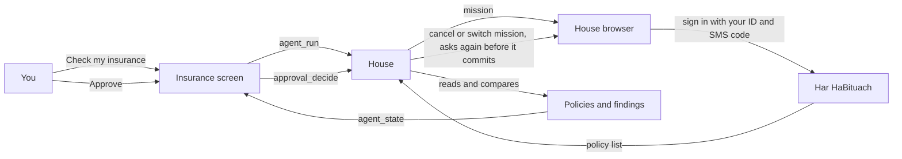
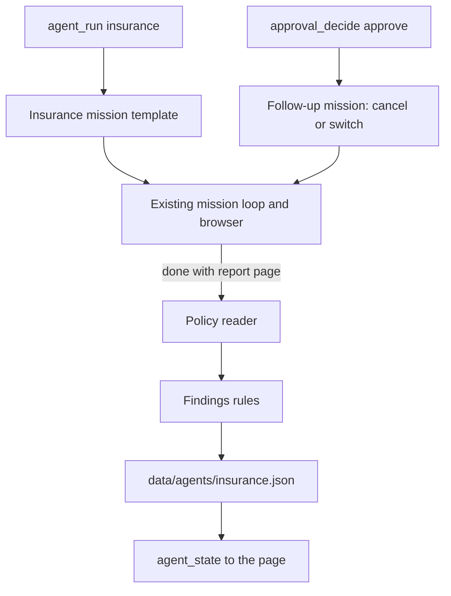

# Opero Insurance agent

The Insurance agent reads every policy the person holds, shows the short version, and asks for an OK before it cancels or switches anything. Its screen is the template for every later agent (Bills, Groceries, Food planning).



## What ships when

| Piece | Lane | State |
| --- | --- | --- |
| Insurance screen, Home card, nav entry, sample-data preview | page | Built on `feat/insurance-agent` |
| "Check my insurance" button that sends today's `mission` | page | Built, uses the current contract |
| New message types below | contract | This spec. Next pull request |
| Insurance runner, reader, findings, store, approvals | house | This spec. After the contract |
| Page reads `agent_state` instead of sample data | page | After the contract |
| Upcoming checks on a schedule | house + page | Later phase |

The page works today in two ways. `?demo=insurance` fills the screen with the design's sample policies and says so in a banner. "Check my insurance" sends an ordinary `mission`, so the house agent signs in to Har HaBituach and answers in chat. The structured summary, approvals, and policy table need the house work below.

## Contract pull request

Add these to `frontend/socket-contract.json`, then run `node scripts/generate-contract-tables.mjs`. All are new types. Nothing existing changes shape, so the house and the page can follow in either order.

### Page → house

| `type` | Fields | Meaning |
| --- | --- | --- |
| `agents_list` | _(none)_ | Ask for the agent list. |
| `agent_state` | `agent` (string) | Ask for one agent's saved state. |
| `agent_run` | `agent` (string) | Start that agent's check now. |
| `approval_decide` | `agent` (string), `id` (string), `decision` ("approve" \| "decline") | The person's answer to one card in Needs your OK. |
| `agent_chat` | `agent` (string), `text` (string) | A chat line about that agent's results. |
| `schedule_toggle` | `agent` (string), `id` (string), `enabled` (boolean) | Turn one upcoming check on or off. Later phase. |

### House → page

| `type` | Fields | Meaning |
| --- | --- | --- |
| `agents` | `items` (array) | One row per agent: `id`, `name`, `product` ("home" \| "business" \| "health"), `state` ("active" \| "coming_soon"), `pending` (number). |
| `agent_state` | `agent` (string), `state` (object) | Everything the agent screen shows. Shape below. Sent on `agent_state`, after a run, and after each decision. |
| `agent_message` | `agent` (string), `role` ("user" \| "agent"), `text` (string) | A chat line in that agent's panel. |

`agent_state.state` for Insurance:

```json
{
  "checkedAt": 1795564800000,
  "running": false,
  "summary": {
    "sentence": "You have 7 active policies. Two changes could save you about ₪3,700 a year. They need your OK.",
    "nowMonthly": 785,
    "afterMonthly": 475,
    "currency": "ILS"
  },
  "approvals": [
    {
      "id": "apr_health_dup",
      "title": "Cancel the duplicate health policy",
      "reason": "You are covered twice for private health…",
      "saving": { "amount": 142, "per": "month" },
      "secondary": "ask",
      "status": "pending"
    }
  ],
  "items": [
    { "id": "pol_car", "name": "Car — comprehensive", "company": "Insurer A", "price": { "amount": 4860, "per": "year" }, "status": "renews", "statusDate": "2026-12-12" }
  ],
  "log": [{ "at": 1795560720000, "text": "Signed in to Har HaBituach" }],
  "schedule": []
}
```

- `approvals[].status` is "pending", "approved", "declined", "running", "done", or "failed".
- `items[].status` is "good", "duplicate", "renews", or "unknown". The page words them. The house does not send display text for chips.
- `secondary` is "ask" or "quotes". The page turns it into "Ask a question" or "See the quotes" and sends `agent_chat`.
- Money is a number in shekels. The page formats it.
- Policy numbers, ID numbers, and SMS codes never travel on the socket.

## House pull request



### 1. Agent registry

`src/agents/registry.ts` lists the agents: `insurance` active, `bills`, `groceries`, `food` coming soon. `agents` is built from it, with `pending` counted from each agent's stored approvals. Names and agent ids go in `src/config.ts` with the other shared strings.

### 2. Insurance run

`agent_run { agent: "insurance" }` starts a normal mission through the existing loop, with a fixed request and End from `src/config.ts`:

- Site: Har HaBituach, the Capital Market Authority registry (`HAR_HABITUACH_URL` in config).
- End: the "my policies" report page lists every active policy.
- Sign-in uses the government identification flow. The agent asks for the ID number through the vault (description "Israeli ID number"). It asks the person for the SMS code with `ask` reason `code`. A bot check hands control to the person, as today.
- The run follows the current rules: a newer mission aborts the old one, and one browser serves all agents.

While the mission belongs to Insurance, each `lastAction` from the work status board is appended to the agent log with its time.

### 3. Policy reader

When the mission ends `done`, read the report page text (or the downloadable report, when the site offers one) and ask the model for a fixed JSON list of policies: name, type, company, price and period, start date, end or renewal date, and whether it is paid by an employer. Validate the JSON. Drop rows that do not validate and log how many were dropped. The model sees the page text, never vault values.

### 4. Findings rules

Plain rules, no model, in `src/agents/insurance/findings.ts`, with tests:

- Duplicate cover: two active policies of the same health or life type, one through an employer → one approval to cancel the personal policy, with its monthly saving.
- Renewal soon: a car or home policy that renews within `RENEWAL_WINDOW_DAYS` (config, 45) → one approval to compare quotes at renewal. The saving is filled in only after quotes exist (later step below).
- Everything else is "good". Rows the rules cannot judge are "unknown". They are never "good" by default.

The summary sentence is built from these counts in config strings for English and Hebrew. It is written for a person who knows nothing about insurance.

### 5. Store

`data/agents/insurance.json` holds `checkedAt`, `summary`, `approvals`, `items`, `log` (the last `AGENT_LOG_LIMIT` lines), and `schedule`. Same read and write style as `house-store.ts`. It sits in `data/`, which is ignored by git and stays on this machine.

### 6. Decisions

- `decline` marks the approval declined and changes nothing else.
- `approve` marks it running and starts a follow-up mission (cancel the policy at its insurer, or switch at renewal). The page OK does not replace the commit approval. The loop still stops before the final cancel or pay click and asks in chat. The approval becomes done or failed from the mission result.
- `agent_chat` answers from the stored state with the model and no browser. If the answer needs the web, it starts a mission and says so.

### 7. Quotes (later)

Switching car insurance needs quotes from several insurers with the same coverage and deductible. That is one mission per insurer, with the person's car details from the vault. Until it exists, the renewal card says the renewal date and offers "Ask a question" only.

### 8. Upcoming checks (later)

A small scheduler in the house runs enabled jobs (monthly full check, daily price watch until a renewal). It only runs when no other mission is live. `schedule_toggle` flips `enabled`.

## Page pull request after the contract

- On open of `#insurance`, send `agent_state { agent: "insurance" }`. Render `agent_state` with the same functions the sample data uses today.
- "Check my insurance" sends `agent_run` instead of the mission sentence.
- Approve and Decline send `approval_decide`. The secondary button sends `agent_chat`.
- The Home card and the nav read `agents` for state and the pending count.
- Remove the `?demo=insurance` sample data, or keep it behind the same query for design reviews.

## Tests

- House: findings rules (duplicate, renewal window, unknown rows), reader validation drops bad rows, store round trip, `approval_decide` never starts a commit without the chat OK, unknown agent id is ignored.
- Contract: the new types are in the generated tables. `explainMessage` rejects a wrong `decision`.
- Page: sends only contract types. With sample data the screen shows the summary, two approvals, seven policies, and five log lines.

## Open questions

- Har HaBituach sign-in may need a one-time code each time. Is a monthly automatic check acceptable if it always stops for the code?
- Should the Insurance chat stay in the shared house thread until `agent_message` exists, or wait for it?
- Hebrew at launch for the summary sentence and chips, or English first?
- Who supplies insurer cancellation addresses and forms when an insurer has no online cancel?
