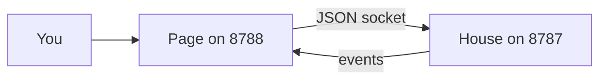

# Opero frontend ↔ house socket contract

This file is the boundary between the page package (`frontend/`) and the house process (`src/`). The page may be plain HTML today and React later. It must speak only the message types listed here. Do not invent types, rename fields, or reintroduce a `labels` push from the house.

## Ports and how to run

| Process | Bind | Role |
| --- | --- | --- |
| House | `127.0.0.1:8787` | WebSocket for all page traffic. HTTP is health JSON only: `{ "service": "opero-home", "ok": true }`. |
| Page | `127.0.0.1:8788` | Static (or later bundler) server for the Opero UI. |

Commands from the repo root:

- House: `npm run dev` or `npm run dev:fake`
- Page: `npm run dev:page`
- Open: `http://127.0.0.1:8788`

The page opens `ws://127.0.0.1:8787` by default (configurable, for example via frontend config or a `?house=` query override). Screenshot frames travel on that same socket. The page package does not import `src/`.

## Ownership of strings

- **Page owns chrome strings** (titles, placeholders, button captions, status-pill wording, vault/key card copy). After the split those live in `frontend/labels.js`. The page applies them from `settings.language` and when the language select changes.
- **House owns server result strings** shown as message text, for example `"Saved."`, `"Removed."`, `"Not found."`, `"Key saved on this machine."`, `"Paste a Grok API key."`, `"Checking key…"`, and agent chat lines. The page displays `message` / `key_result.message` / `vault_result.message` as received.

## `labels` is removed

The house **does not** send `{ "type": "labels", ... }` on connect or on language change. The page must not wait for a `labels` event. Language preference still travels as:

- Page → house: `{ "type": "language", "language": "en" | "he" }`
- House → page: `settings.language` (and the house keeps language for the planner)

## Transport

- Framing: one JSON object per WebSocket text frame.
- No path check and no origin check on the house WebSocket (so the page on 8788 can connect).
- Field `type` is required on every message in both directions.

## Page → house

The page **only** sends the types below. The house still accepts `steer` and `answer` as aliases of `mission` for older clients; the page must not send those aliases.

| `type` | Fields | Notes |
| --- | --- | --- |
| `mission` | `text` (string) | Chat line: clarify, start, steer, answer, or abort-and-start. |
| `edit_end` | `end` (string) | Replace the mission end. Steps are not edited from the page. |
| `level` | `level` (`1` \| `2`) | Stored on the house; applied on the next mission start. |
| `language` | `language` (`"en"` \| `"he"`) | Stored on the house for the planner; page updates its own chrome. |
| `driver` | `text` (`"user"` \| `"agent"`) | Take control / hand back. |
| `save_key` | `key` (string) | Grok API key paste. |
| `vault_list` | _(none)_ | Ask the house to reply with `vault`. |
| `vault_save` | `description` (string), `value` (string) | Save a vault entry. |
| `vault_remove` | `description` (string) | Remove a vault entry by description. |
| `click` | `x` (number), `y` (number) | Image pixels after letterbox mapping (see below). Only meaningful while driver is `user`. |
| `scroll` | `direction` (`"up"` \| `"down"`) | User scroll while driving. |
| `press` | `key` (string) | e.g. `Enter`, `Tab`, `Backspace`. |
| `type` | `text` (string) | Typed character(s) while driving. |
| `work_status` | _(none)_ | Ask for the current status board; house replies with `work_status`. |

### Click coordinates

`click.x` and `click.y` are **image pixels**, not CSS box pixels. Map the pointer through the letterboxed picture (same math as `mapPictureClick`: scale to fit, ignore padding outside the drawn image). Clicks on letterbox padding are not sent.

## House → page

| `type` | Fields | Notes |
| --- | --- | --- |
| `settings` | `level` (`1` \| `2`), `language` (`"en"` \| `"he"`), `workStatusPollMs` (number) | Sent on connect. Page syncs controls and poll interval. |
| `ready` | `ready` (boolean), `mode` (string) | Whether a live key (or fake mode) is available. |
| `key_result` | `ok` (`true` \| `false` \| `null`), `message` (string) | Key save progress; `null` means in progress. |
| `thread` | `messages` (`{ role: "user" \| "agent", text: string }[]`) | Full replayed conversation on connect. |
| `message` | `role` (`"user"` \| `"agent"`), `text` (string) | One new chat line. |
| `thinking` | `text` (string) | Transient thinking line; clear on the next `message` or `question`. |
| `question` | `question` (string), `reason` (string) | Agent question. The page may ignore `reason` and show `question` as an agent line. |
| `status` | `status` (mission status string) | e.g. `planning`, `running`, `waiting_on_user`, `done`, `blocked`, `aborted`. |
| `plan` | `mission` (object) | Mission payload. The page requires at least `end`, `steps` (each with `text`, `site`, `doneWhen`), and `status`. Extra mission fields may be present; ignore what the UI does not use. |
| `screen` | `image` (base64 JPEG string), `width` (number), `height` (number) | Live computer frame. |
| `driver` | `driver` (`"user"` \| `"agent"`) | Who is driving the computer. |
| `vault` | `items` (`string[]`) | Descriptions only (no secret values). |
| `vault_result` | `ok` (boolean), `message` (string) | Result of save/remove. |
| `work_status` | `status` (status board object or `null`) | Board fields when present: `missionId`, `phase`, `stepHint`, `lastAction`, `challenge`, `updatedAt`, `detail`, and optional `stagnantActions`, `failedOpen`, `siteError`, `budgetUsed`. |

On connect the house sends, in order of current practice: `settings`, `ready`, `vault`, `thread`, and `plan` when a mission exists (live or last). It does **not** send `labels`.

## Verification DOM contract

Verification (`.cursor/skills/verify-opero`) drives accessible names and these ids. Keep them unless the verify skill is updated in the **same** change.

### Stable element ids

`title`, `subtitle`, `conn-pill`, `conn-text`, `mission-pill`, `mission-text`, `level-label`, `level`, `language-label`, `language`, `vault-open`, `chat-heading`, `ready-badge`, `thread`, `composer`, `mission`, `send`, `plan-label`, `end-label`, `end`, `steps`, `steps-empty`, `screen-heading`, `screen`, `screen-idle`, `idle-title`, `idle-text`, `take`, `hand`, `driver-hint`, `key-overlay`, `key-title`, `key-body`, `key-input`, `key-save`, `key-msg`, `vault-overlay`, `vault-title`, `vault-body`, `vault-description`, `vault-value`, `vault-save`, `vault-close`, `vault-msg`, `vault-list`, and the transient `#thinking` line inside `#thread`.

### Button accessible names (English / Hebrew)

| Control | English | Hebrew |
| --- | --- | --- |
| Send | `Send` | `שליחה` |
| Take control | `Take control` | `קחו שליטה` |
| I'm done | `I'm done` | `סיימתי` |
| Vault open | `Vault` | `כספת` |
| Vault save | `Save` | `שמירה` |
| Vault close | `Close` | `סגירה` |
| Vault remove (per row) | `Remove` | `הסרה` |
| Save key | `Save key` | `שמירת מפתח` |

Connection and ready copy used by doctor: `Live` / `מחובר`, `Offline` / `מנותק`, `Ready` / `מוכן`, and key-card title `Connect Grok` / `חיבור ל-Grok`.

## Non-negotiables

1. Do not add page→house or house→page `type` values outside this document.
2. Do not send `labels` from the house; do not require `labels` in the page.
3. Do not move the page back onto 8787 HTTP; health JSON stays on 8787, UI on 8788.
4. Changing a listed DOM id or verification button name requires updating the verify skill in the same change.
